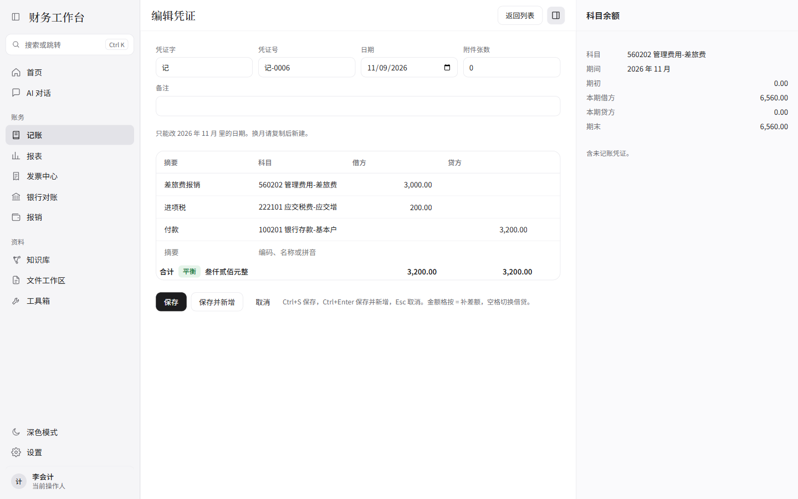
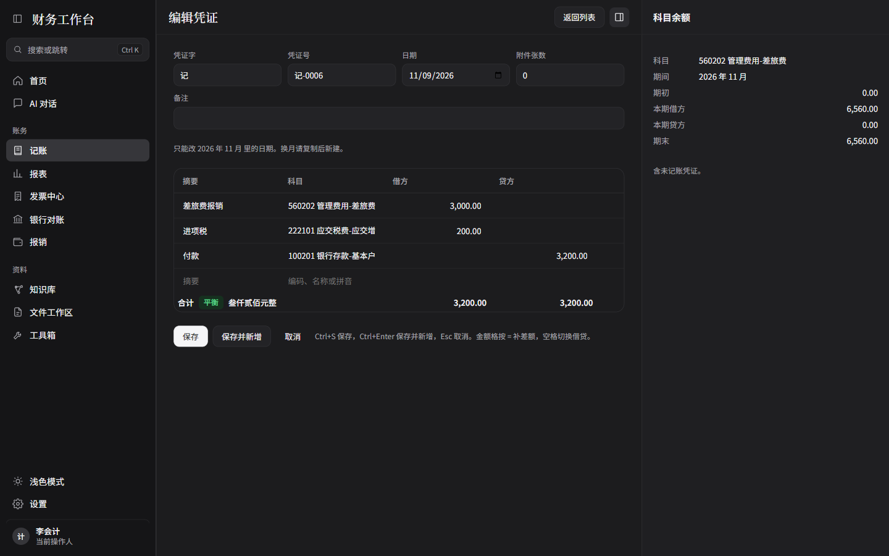
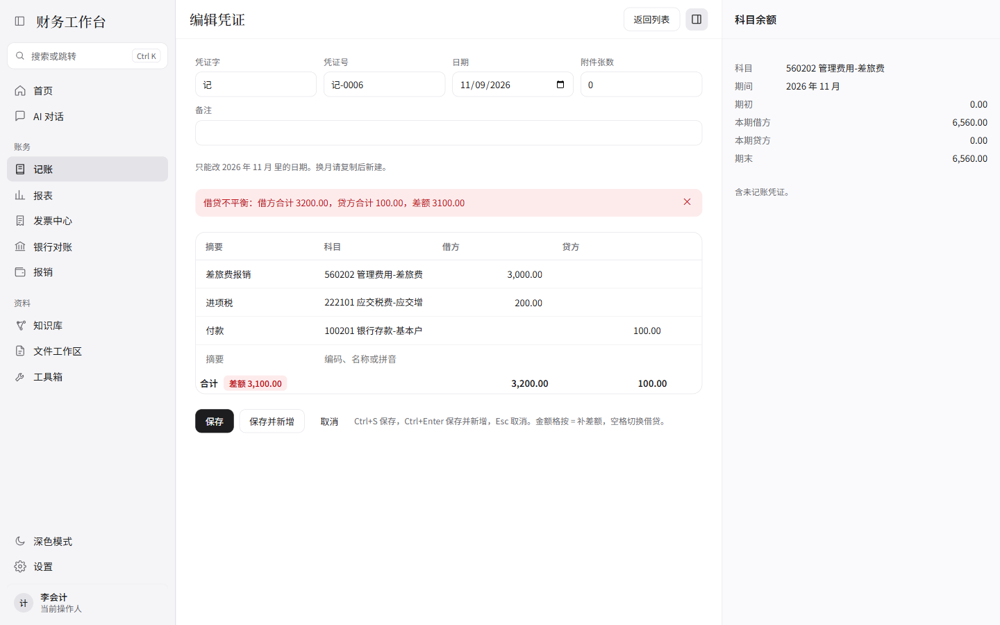

# F01 报告：凭证录入

分支 `f01-voucher-entry`。

## 完成情况

验收标准：

1. 通过。`pytest` 18 项通过；`npm test` 4 项通过；`npm run build`（`tsc -b` 与 vite）通过。
2. 通过。李会计不用鼠标录了三行：差旅费 3000、进项税 180、银行存款按 `=` 得到 3180，Ctrl+S 保存为记-0006，列表状态是待审核。之后把进项税改成 200 并保存，列表和详情都是 3,200.00。
3. 通过。`clf` 只命中管理费用-差旅费；`1002` 只列出银行存款-基本户，上级科目银行存款不出现。
4. 通过。借贷不平点保存，表格上方显示后端原文，例如“借贷不平衡：借方合计 3200.00，贷方合计 100.00，差额 3100.00”。
5. 通过。草稿改金额后详情更新。已审核的记-0004 详情没有“编辑”“删除”，仍有原来的“记账”“反审核”。直接打开 `/ledger/4/edit` 显示“只有草稿可以修改”，并有“返回列表”。
6. 通过。复制记-0006 后分录预填，日期是今天（2026-11-09），备注和附件清空，预览号是记-0007；保存后列表出现记-0007。
7. 通过。删除记-0007 时页面内确认“确定删除记-0007？”，确认后列表回到 6 张，右侧详情关掉。
8. 通过。单测覆盖 1280.00 → 壹仟贰佰捌拾元整、3180.50 → 叁仟壹佰捌拾元伍角。页面上 3,180.00 显示叁仟壹佰捌拾元整，3,200.00 显示叁仟贰佰元整。
9. 通过。深色模式截图见下。图标按钮沿用外壳的悬浮提示；行删除按钮也有“删除这一行”。
10. 通过。本报告和三张 1440×900 截图。

另外补上的六点：

1. 通过。拼音对整个科目名调用一次 `lazy_pinyin(..., Style.FIRST_LETTER)`。测试断言“应交税费-应交增值税(进项税额)”的 `py` 含 `jx`。
2. 通过。编辑草稿时日期框限制在原期间；改到别的月份会提示“不能改到其他期间，请复制后新建”。后端 `period_change` 同样拒绝。
3. 通过。Esc 先关科目下拉或摘要联想，再关确认条，都没有时才离开。有未保存内容时先出“有未保存的内容，确定离开？”。Ctrl+S、Ctrl+Enter 调用了 `preventDefault`。
4. 通过。金额格粘贴 `1,234.50` 后去掉逗号，显示 1,234.50；粘贴 `abc`、`12.345` 等不合法内容保持原值。
5. 通过。单测：100010.00 → 壹拾万零壹拾元整；1000000.05 → 壹佰万元零伍分；20000.30 → 贰万元零叁角。
6. 通过。进入录入页会打开右侧栏，离开后恢复进来之前的开关。原来关着，离开后仍关着；原来开着，离开后仍开着。

## 改动文件

- `services/core/pyproject.toml`、`services/core/src/finance_core/pinyin.py`
- `services/core/src/finance_core/api.py`、`ledger.py`、`services/core/tests/test_api.py`
- `docs/CONTRACT.md` 第 2 节
- `apps/desktop/src/shared/api.ts`
- `apps/desktop/src/lib/format.ts`、`format.test.ts`、`routes.ts`
- `apps/desktop/src/App.tsx`、`pages/VoucherEntryPage.tsx`、`LedgerPage.tsx`、`VoucherDetail.tsx`
- `apps/desktop/src/components/AccountPicker.tsx`、`SummaryField.tsx`、`MoneyInput.tsx`、`ConfirmBar.tsx`、`Icon.tsx`、`RightPane.tsx`、`Shell.tsx`
- `apps/desktop/src/styles/desktop.css`、`vite.config.ts`、`package.json`、`package-lock.json`
- `THIRD_PARTY.md`
- `docs/reports/F01-report.md`、`docs/reports/img/F01-light.png`、`F01-dark.png`、`F01-error.png`

## 契约和规则改动

新增只读接口（要令牌，不要求 `X-FW-User`）：

| 方法 | 路径 | 说明 |
|---|---|---|
| GET | `/api/accounts` | 每项增加 `py` |
| GET | `/api/accounts/{code}/balance` | `period`、`include_unposted`（默认 false） |
| GET | `/api/summaries` | `q`、`limit`（默认 10），去重后的字符串数组 |
| GET | `/api/vouchers/next-number` | 预览下一号，不占号。路由写在 `/api/vouchers/{id}` 之前 |

`ledger.py` 新增 `next_display_no`、`recent_summaries`。编辑凭证仍不能改凭证字和期间，期间不一致返回 `period_change`。原有借贷平衡、审核人不能是制单人、已结账不能改、AI 不能审核/记账/结账都没有放宽。MCP 没有新增写工具。

## 本机怎么验证

```powershell
cd services/core
python -m pytest -q

cd ..\..\apps\desktop
npm test
npm run build
```

界面：另开一个空数据目录，`FW_DEMO=1`、`FW_API_TOKEN` 自定，`PYTHONPATH` 指向 `services/core/src`，启动 `finance_core.api`。`apps/desktop/.env.local`（不要提交）写 `VITE_FW_TOKEN` 和 `VITE_FW_BASE_URL=http://127.0.0.1:8765`，然后 `npm run dev`，打开 `http://localhost:1420/#/ledger`。当前操作人用李会计。

## 第三方

依赖，没有把源码拷进仓库：

- `pypinyin` 0.55.0，MIT
- `vitest` 2.1.8，MIT

图标是自己画的，没有新的图标库。

## 疑问和遗留

- 任务卡写已审核、已记账的详情“只显示复制”。实现保留了原来的“记账”“反审核”，没有“编辑”和“删除”。
- 最后一行贷方按 Enter 增行、新行带上一条摘要、金额格空格对调借贷、Ctrl+Enter 保存并新增，都已实现。浏览器验收用默认的四行录完三行分录，这几项没有单独点过。
- 验收时把临时演示库里的记-0004 审成了已审核，并把记-0006 改成了 3,200.00。这个库在系统临时目录，不在仓库里。

## 截图

1440×900。






